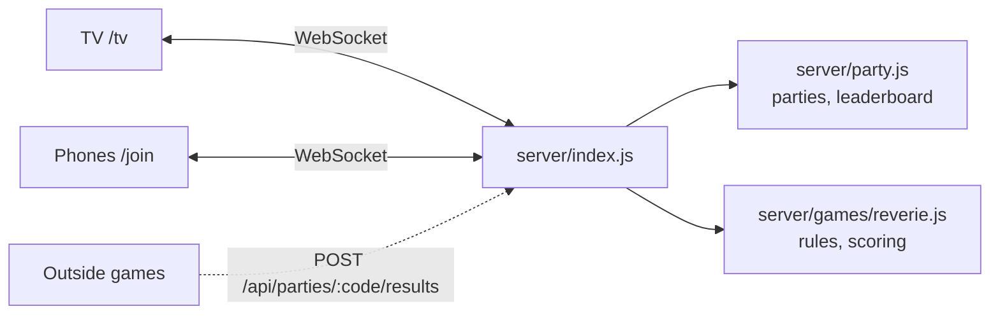

<div align="center">

# Shaam

**One party code for the whole game night. Every game counts towards one leaderboard.**

[Open it](https://shaam.futile.studio) · [Adding a game](GAMES.md) · [Futile Studio](https://futile.studio)

[](https://shaam.futile.studio)


[](https://github.com/MayurJivani/Shaam/commits/main)

</div>

> **Futile Studio** · Party games, game night hub · Live, started Nov 2026

## Overview

Party games for one TV and a room full of phones. Start a party on the TV,
everyone joins once with a code, and every game played that night counts
towards one leaderboard.

Shaam is the evening around the games: one party code, one guest list, and one
scoreboard. The idea is that a group joins once, plays several games without
rejoining, and ends the night knowing who did best overall.

- **Reverie** is built in: a storytelling and guessing game in the spirit of
  Dixit for 3 to 12 players.
- **Noggin, Chorusify, Croon, Katze, Consensus and Dabber** launch from the same
  shelf and play exactly as they always have. Their result is typed in on the
  party TV.

Adding a game, built-in or outside: [GAMES.md](GAMES.md).

## How a night works

1. The host opens `/tv` on the TV. It shows a QR code and a party code.
2. Guests scan it on their phones (`/join`) and pick a name once.
3. The host picks a game off the shelf. Games can be switched off for the night
   with the "In tonight" toggle.
4. For Reverie, phones follow the TV into the game and back out at the end. The
   result goes to the party on its own.
5. For an outside game, the host opens its room and types the room code into
   the party TV. Every phone gets an "Open <game>" button with the code and
   name filled in, so it is one tap. Afterwards the host types the scores into
   the form on the TV.

The leaderboard ranks by placement (one point per player beaten), so 900 Noggin
points and 30 Reverie points weigh the same.

## Reverie

- Each player holds 6 cards. The storyteller picks one and gives a clue, the
  others each play a card that fits, then everyone votes for the storyteller's.
- Scoring: if nobody or everybody finds it, the storyteller gets 0 and everyone
  else 2. Otherwise the storyteller and each correct guesser get 3. On top, 1
  point per vote your own card drew, capped at 3.
- The host sets max players (6 to 12), rounds, and the timers for submitting,
  discussing and voting. Clocks can be paused.
- Custom clues can be turned off, then the storyteller picks one of three
  offered prompts.
- Seats survive reconnects. A player who drops is marked, and the game carries on.
- Picture packs:
  - **Dreamscapes**, 240 original surreal scenes drawn in code (`src/lib/cardArt.js`)
  - **Visions**, symbolists and visionaries (Redon, Blake, Goya, Bosch, Moreau)
  - **Floating World**, Japanese woodblock prints
  - **Cabinet of Curiosities**, odd creatures, insects and devils from old prints
  - **Lost Worlds**, ruins, abysses, storms and impossible cities

The photo packs are public-domain (CC0) works from
[The Met's open collection](https://www.metmuseum.org/art/collection). Credits
for every card are in `public/packs/<slug>/credits.json` and `shared/packs.js`.

## Stack

- Astro 7 (static output) with React 19 islands for the TV and phone screens
- Node 22 relay: plain `http` plus `ws` for the WebSocket, `qrcode` for the join QR
- Parties persist as JSON files in a data directory
- Tests with `node --test`

## Architecture



The relay owns the connections and the clock. A built-in game is plain
functions over a room object, and every screen gets a redacted view (hands and
votes stay private until the reveal). The full engine contract, and the optional
results API for outside games, are in [GAMES.md](GAMES.md).

## Running it locally

Needs Node 22.12 or newer.

```bash
npm install
npm run dev      # relay on :4401, pages on :4400 (open /tv on the TV, scan the QR with phones)
npm test
npm run build && npm start   # production: one process serves dist/, /api and /ws on :4401
```

`npm run dev` binds to `0.0.0.0`, so phones on the same wifi can reach it.

To rebuild the picture packs from The Met (needs ImageMagick's `magick`):

```bash
node scripts/packs.mjs            # build missing packs, keep finished ones
node scripts/packs.mjs ukiyo      # also rebuild this one
```

There is also a `Dockerfile` that builds one container serving everything on
port 4401. On push to `main`, a GitHub Action builds the image and pushes it to
GHCR. `deploy/` holds the compose file and Caddy block I use to host it.

## Configuration

| Variable | Default | Purpose |
| --- | --- | --- |
| `SHAAM_PORT` | `4401` | port for the relay (dev proxy follows it) |
| `SHAAM_DIST_DIR` | `dist/` | where the built site is served from |
| `SHAAM_DATA_DIR` | `data/` | where parties are saved, so they survive a restart |

## Project structure

| Path | What |
| --- | --- |
| `server/index.js` | relay: static files, `/api`, the WebSocket |
| `server/party.js` | parties, the cross-game leaderboard, JSON persistence in `data/` |
| `server/games/reverie.js` | Reverie's rules, scoring and redacted views |
| `shared/games.js` | the shelf |
| `shared/packs.js` | Reverie picture packs and their credits (generated) |
| `src/lib/cardArt.js` | the Reverie deck as seeded SVG scenes |
| `src/pages/` | `/`, `/tv`, `/join`, `/reverie` (TV) and `/reverie/play` (phone) |

## Licence

No licence file yet, all rights reserved. The Met images in `public/packs/` are
public domain (CC0).

---

<p align="center"><sub>Built by <a href="https://github.com/MayurJivani">Mayur Jivani</a> at <a href="https://futile.studio">Futile Studio</a>. Everything is futile. Do it anyway.</sub></p>
