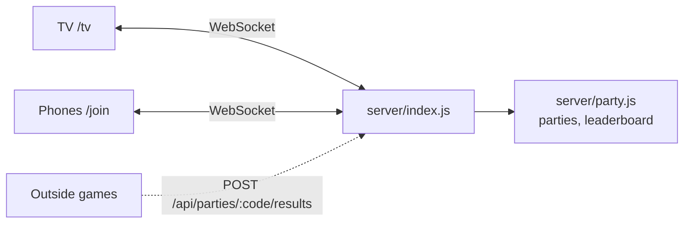

<div align="center">

# Shaam

**One party code for the whole game night. Every game counts towards one leaderboard.**

[Open it](https://shaam.futile.studio) · [Adding a game](GAMES.md) · [Futile Studio](https://futile.studio)

[](https://shaam.futile.studio)


[](https://github.com/MayurJivani/Shaam/commits/main)

</div>

> **Futile Studio** · Party games, game night hub · Live, started Nov 2026

## Overview

Party games for one TV and a room full of phones. Start a party on the TV,
everyone joins once with a code, and every game played that night counts
towards one leaderboard.

Shaam is the evening around the games: one party code, one guest list, and one
scoreboard. The idea is that a group joins once, plays several games without
rejoining, and ends the night knowing who did best overall.

Every game is listed on the front page and starts with one tap, party or not.

- **Undercover** is a hidden-word bluffing game for 3 to 20 players, played on
  one phone passed round the room.
- **Noggin, Chorusify, Bleep, Haggle, Croon, Katze, Consensus and Dabber** launch from the same
  shelf and play exactly as they always have. Their result is typed in on the
  party TV.

Adding a game, built-in or outside: [GAMES.md](GAMES.md).

## How a night works

1. The host opens `/tv` on the TV. It shows a QR code and a party code.
2. Guests scan it on their phones (`/join`) and pick a name once.
3. The host picks a game off the shelf. Games can be switched off for the night
   with the "In tonight" toggle.
4. For Undercover, the host plays it on one phone and types the scores in after.
5. For an outside game, the host opens its room and types the room code into
   the party TV. Every phone gets an "Open <game>" button with the code and
   name filled in, so it is one tap. Afterwards the host types the scores into
   the form on the TV.

The leaderboard ranks by placement (one point per player beaten), so 900 Noggin
points and 6 Undercover points weigh the same.

## Undercover

- Most players are Civilians and share a secret word. The Undercovers get a
  close cousin of it (Coffee and Tea), and Mr White gets nothing. Undercovers
  are not told they are undercover.
- One phone does everything. It goes round so each player sees their word in
  private, then shows the speaking order (Mr White never goes first). Everyone
  says one clue out loud, the room agrees who to vote out, and the phone
  reveals what they were.
- A caught Mr White types one guess at the Civilians' word and wins alone if right.
- Civilians win by clearing every impostor; impostors win once one Civilian is
  left. Points: Civilians 2 each, Undercovers 10, a surviving Mr White 6.
- The host picks how many Undercovers and Mr Whites, and can play again with
  the same players.

## Stack

- Astro 7 (static output) with React 19 islands for the TV and phone screens
- Node 22 relay: plain `http` plus `ws` for the WebSocket, `qrcode` for the join QR
- Parties persist as JSON files in a data directory
- Tests with `node --test`

## Architecture



The relay owns the connections and the clock. A built-in game would be plain
functions over a room object, with every screen getting a redacted view.
Undercover needs no server: its rules are plain functions in
`shared/undercover.js`, run in the browser and saved to localStorage. The full engine contract, and the optional
results API for outside games, are in [GAMES.md](GAMES.md).

## Running it locally

Needs Node 22.12 or newer.

```bash
npm install
npm run dev      # relay on :4401, pages on :4400 (open /tv on the TV, scan the QR with phones)
npm test
npm run build && npm start   # production: one process serves dist/, /api and /ws on :4401
```

`npm run dev` binds to `0.0.0.0`, so phones on the same wifi can reach it.

There is also a `Dockerfile` that builds one container serving everything on
port 4401. On push to `main`, a GitHub Action builds the image and pushes it to
GHCR. `deploy/` holds the compose file and Caddy block I use to host it.

## Configuration

| Variable | Default | Purpose |
| --- | --- | --- |
| `SHAAM_PORT` | `4401` | port for the relay (dev proxy follows it) |
| `SHAAM_DIST_DIR` | `dist/` | where the built site is served from |
| `SHAAM_DATA_DIR` | `data/` | where parties are saved, so they survive a restart |

## Project structure

| Path | What |
| --- | --- |
| `server/index.js` | relay: static files, `/api`, the WebSocket |
| `server/party.js` | parties, the cross-game leaderboard, JSON persistence in `data/` |
| `shared/undercover.js` | Undercover's rules, word pairs and scoring |
| `shared/games.js` | the shelf |
| `src/pages/` | `/`, `/tv`, `/join`, `/undercover` (one phone) |

## Licence

No licence file yet, all rights reserved.

---

<p align="center">
  <a href="https://futile.studio"></a>
  <br>
  <sub>Built by <a href="https://github.com/MayurJivani">Mayur Jivani</a>. Everything is futile. Do it anyway.</sub>
</p>
